  

# 🔤 Awesome Digital Font Subscription Service

  
  
  
  
  
  

> 📚 **Curated directory of SaaS digital font subscription services, web typography APIs, desktop licensing platforms, and open-source font ecosystems.** Discover pricing tiers, free trial limits, enterprise valuations, and ranked open-source typography alternatives.

---

## 📑 Table of Contents

- [🔍 Overview](#-overview)
- [📊 Sector Overview & Market Dynamics](#-sector-overview--market-dynamics)
- [💎 SaaS / Commercial Hosted Platforms](#-saas--commercial-hosted-platforms)
- [🌟 Open-Source GitHub Projects](#-open-source-github-projects)
- [🤝 How to Contribute](#-how-to-contribute)
- [💖 Support](#-support)
- [📈 Star History](#-star-history)
- [⚖️ Disclaimer](#️-disclaimer)

---

## 🔍 Overview

Modern digital design, responsive web applications, and corporate branding demand dependable, legally compliant typography infrastructure. This repository provides an SEO-optimized, highly structured comparative guide to:

- 💻 **Commercial Font Subscription Platforms (SaaS):** Multi-seat syncing, web font hosting, and perpetual desktop licensing catalogs.
- 🌐 **Web Font CDNs & APIs:** High-availability font delivery networks with latency optimization and subsetting.
- 🔓 **Open-Source Font Repositories & OFL Ecosystems:** Free, self-hostable variable font families and build toolchains.
- 🏷️ **Transparent Pricing & Free Tier Limits:** Detailed costs per seat/pageview, trial duration, and licensing restrictions.

---

## 📊 Sector Overview & Market Dynamics

The global digital typeface and font licensing market is valued at approximately **$1.2B to $1.25B** (projected to reach ~$1.8B by 2032 with a 4.2% CAGR), while the broader web font delivery segment represents an additional **$2.6B** market. 

The industry is **highly concentrated and oligopolistic** at the enterprise tier—dominated by conglomerates **Monotype Imaging** (which systematically acquired MyFonts, Linotype, Fontsmith, Hoefler & Co., and FontShop) and **Adobe Inc.** (Adobe Fonts bundled with Creative Cloud). Together they capture the majority of high-end corporate licensing. Simultaneously, an open-source movement spearheaded by **Google Fonts** and **Fontsource** delivers royalty-free typography for millions of web apps, while independent boutique foundries protect distinct creative licenses via agencies like **Type Network**.

---

## 💎 SaaS / Commercial Hosted Platforms

A side-by-side comparison of leading commercial digital font subscription services and hosted font platforms, sorted descending by parent company valuation and revenue scale:

| 🏷️ Product | 🏢 Company Size (Valuation / Revenue) | 💰 Pricing | 🎁 Free Tier / Trial Limit | 📝 Description |
| :--- | :--- | :--- | :--- | :--- |
| **[Google Fonts](https://fonts.google.com/)** | ~$3.86T Market Cap (Alphabet) / $350B+ Rev | Free ($0) | Free forever (1,700+ font families & variable fonts without pageview caps or seat restrictions) | Cloud-hosted open-source font distribution and web-font service optimized for performant delivery. |
| **[Adobe Fonts](https://fonts.adobe.com/)** | ~$100B Market Cap (Adobe Inc.) / $21.5B Rev | $9.99/mo (via Adobe InCopy or single-app plan); included with Creative Cloud ($59.99/mo) | Free tier available via basic Adobe ID: limited to ~5,500 basic fonts (paid subscription unlocks 30,000+ fonts for personal and commercial desktop & web use) | All-you-can-use subscription font service syncing typography across Creative Cloud desktop apps and websites. |
| **[Envato Elements](https://elements.envato.com/fonts)** | ~$170M Parent Cap (Shutterstock) / ~$150M+ Rev | $16.50/mo (billed annually at $198/yr) | 7-day free trial (unlimited commercial font and asset downloads during the 7-day period; no perpetual free tier) | Creative subscription marketplace providing unlimited downloads for over 30,000+ fonts and design templates under a broad commercial license. |
| **[Monotype Fonts](https://www.monotype.com/fonts)** | $825M Private Equity Valuation (HGGC) / ~$250M+ Rev | $2,500/yr starting tier (custom team/enterprise packages) | 30-day free trial (access to 150,000+ fonts restricted to prototyping and internal mockups only; production distribution requires paid plan) | Premier enterprise font subscription system offering unified desktop activation and web licensing for major heritage foundries. |
| **[MyFonts](https://www.myfonts.com/)** | Sub. of Monotype ($825M PE Valuation / ~$250M+ Rev) | $15 to $40 per style (perpetual base tier starting at 10,000 monthly pageviews) | Free trial fonts available per foundry; no recurring free hosting tier for commercial web fonts (all pageviews must be prepaid or licensed) | Largest retail digital font marketplace for individual font families, desktop seats, and cumulative web pageview tiers. |
| **[Fonts.com](https://www.fonts.com/)** | Sub. of Monotype ($825M PE Valuation / ~$250M+ Rev) | Legacy service; migrated to MyFonts ($15-$40/style) and Monotype Fonts ($2,500/yr) | Free trial fonts available via linked Monotype/MyFonts portals; no standalone active free hosting tier | Former major font distributor and subscription catalog; now consolidated under Monotype's modern platforms. |
| **[Linotype](https://www.linotype.com/)** | Sub. of Monotype ($825M PE Valuation / ~$250M+ Rev) | Legacy storefront; purchases fulfilled via MyFonts ($35+/font style base tier) | Free demo font samples for select typefaces; production licensing requires paid tier | Historic foundry responsible for Helvetica, Frutiger, and Univers; now operating under Monotype's centralized catalog. |
| **[Fontspring](https://www.fontspring.com/)** | Sub. of Dribbble / Tiny Ltd. ($50M-$100M segment rev) | $9.95 to $39 per style (perpetual license starting at 500,000 monthly pageviews) | Free "Try Then Buy" demo fonts with no expiration timer (restricted character sets of ~90-100 glyphs; strictly mockups/non-commercial) | Font distributor championing worry-free perpetual licenses, free from subscription renewals and tracking scripts. |
| **[Type Network](https://typenetwork.com/)** | Boutique Private Collective (~$5M-$10M estimated rev / 11-50 employees) | $60/style for base desktop; Enterprise team subscriptions start at $5,000/yr | Free testing/evaluation licenses available upon request for layout mockups (custom client-pitch evaluation files) | Foundry collective representing elite type designers with specialized enterprise subscriptions and bespoke licensing. |
| **[Fontstand](https://fontstand.com/)** | Bootstrapped Boutique Startup (~$1M-$3M estimated rev / <10 employees) | 10% of font retail price per month (typically $3 to $9/mo per style; rent-to-own after 12 months) | 1-hour free trial per font (test up to 10 fonts per day directly in local design apps without manual font file installation) | Native desktop application offering try-before-you-buy, fractional monthly rentals, and rent-to-own terms for independent foundries. |

---

## 🌟 Open-Source GitHub Projects

Curated open-source font families, self-hosting tools, and font management utilities sorted descending by GitHub Stars_Count:

- **[Fira Code](https://github.com/tonsky/FiraCode)**   
  ⚡ Free monospaced font with programming ligatures for code editors and terminal environments.
- **[Font Awesome](https://github.com/FortAwesome/Font-Awesome)**   
  🎨 The world's most popular icon font, vector asset, and CSS toolkit for web and application design.
- **[Nerd Fonts](https://github.com/ryanoasis/nerd-fonts)**   
  🧩 High-volume iconic font aggregator and patcher collecting over 3,600 glyphs across 50+ developer typefaces.
- **[Cascadia Code](https://github.com/microsoft/cascadia-code)**   
  💻 Microsoft's modern monospaced typeface designed for Windows Terminal, VS Code, and development workflows.
- **[Iosevka](https://github.com/be5invis/Iosevka)**   
  📐 Slender, highly customizable open-source algorithmic coding typeface family built from source code.
- **[Google Fonts Repository](https://github.com/google/fonts)**   
  🌐 Official source repository containing the master files for all open-source typefaces distributed via fonts.google.com under the SIL Open Font License (OFL).
- **[Source Code Pro](https://github.com/adobe-fonts/source-code-pro)**   
  🖥️ Adobe's open-source monospaced typeface family crafted specifically for programming and terminal UIs.
- **[Inter](https://github.com/rsms/inter)**   
  📱 Superfamily typeface carefully crafted for computer interfaces, featuring tall x-height and variable axes.
- **[Monaspace](https://github.com/githubnext/monaspace)**   
  🚀 Superfamily of 5 coding fonts by GitHub Next, featuring texture healing, code ligatures, and multiple weights.
- **[Source Han Sans](https://github.com/adobe-fonts/source-han-sans)**   
  🌏 Pan-CJK open-source typeface family covering Simplified Chinese, Traditional Chinese, Japanese, and Korean.
- **[Fontsource](https://github.com/fontsource/fontsource)**   
  📦 Ecosystem of open-source and Google Fonts packaged as individual NPM packages for privacy-first, self-hosted web fonts.
- **[Brick](https://github.com/alfredxing/brick)**   
  🧱 Open-source web font service engineered to deliver open-source fonts in original TTF/WOFF/WOFF2 fidelity without raster distortion.
- **[Fontmake](https://github.com/googlefonts/fontmake)**   
  🛠️ Google Fonts compilation toolchain compiling font sources (UFO, Glyphs) into binary TTF and OTF formats.
- **[gftools](https://github.com/googlefonts/gftools)**   
  🔧 Essential command-line utilities and QA tools for manipulating and testing typefaces for the Google Fonts ecosystem.
- **[Fontmatrix](https://github.com/fontmatrix/fontmatrix)**   
  📁 Cross-platform open-source font management system for Linux, Windows, and macOS with font tagging and activation.

---

## 🤝 How to Contribute

Contributions are always welcome! Help keep this resource comprehensive and up to date:

1. 🍴 Fork the repository.
2. 🌿 Create a new feature branch (`git checkout -b feature/new-font-service`).
3. ✍️ Add or update entries in `README.md` (ensure SaaS services follow the table columns with explicit starting pricing and exact free trial limits).
4. 🚀 Commit your changes (`git commit -m 'feat: add new font service'`).
5. 📤 Push to the branch (`git push origin feature/new-font-service`).
6. 📬 Open a Pull Request with a clear description of changes.

---

## 💖 Support

Thank you so much for visiting this repository! If you find this curated directory useful for your design, development, or enterprise typography workflows, please consider:

- ⭐ **Starring this repository** to help others discover it
- 🍴 **Forking and sharing** it with your developer and designer communities
- ☕ **Buying a coffee & sponsoring ongoing maintenance**: Support via the [GitHub Sponsor Dashboard](https://github.com/sponsors/ishandutta2007)

Your support keeps this curated ecosystem updated and freely accessible to everyone!

---

## 📈 Star History

---

## ⚖️ Disclaimer

- This is a **community-curated** list — not exhaustive and not an endorsement.
- Font licensing is complex. Always verify the specific license (OFL, commercial EULA, perpetual seat rights, pageview limits) for each typeface before deploying in commercial projects, native apps, or distributed software. This repository does not provide legal counsel.

---

  <b>Made with ❤️ for designers, developers, typographers, and open-source advocates worldwide.</b> 
  Let's keep great typography open, accessible, and well-licensed.

